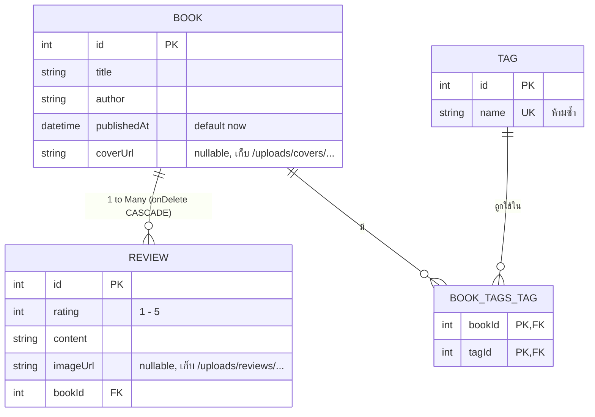
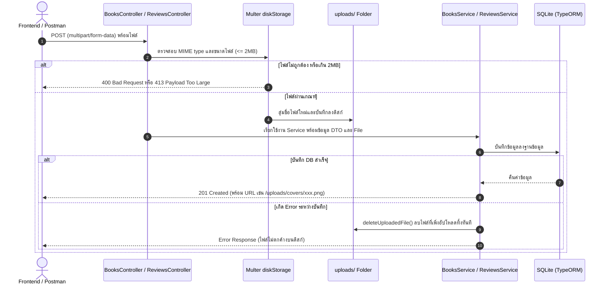

# Book Review API (Backend)

ระบบ API จัดการข้อมูลหนังสือ (Books), รีวิว (Reviews), และแท็ก (Tags) พร้อมระบบอัปโหลดรูปภาพปกและรูปภาพประกอบรีวิว พัฒนาด้วย **NestJS** ร่วมกับ **TypeORM** และฐานข้อมูล **SQLite** พร้อมรองรับ **Swagger UI** สำหรับทดสอบและเชื่อมต่อกับ Frontend (Next.js)

---

## 📋 สารบัญ
1. [ภาพรวมและเทคโนโลยี (Tech Stack)](#ภาพรวมและเทคโนโลยี-tech-stack)
2. [สถาปัตยกรรมและการทำงานของระบบ (How It Works)](#สถาปัตยกรรมและการทำงานของระบบ-how-it-works)
3. [โครงสร้างโปรเจกต์ (Project Structure)](#โครงสร้างโปรเจกต์-project-structure)
4. [ข้อกำหนดและการติดตั้ง (Installation)](#ข้อกำหนดและการติดตั้ง-installation)
5. [การสร้างข้อมูลตัวอย่าง (Database Seeding)](#การสร้างข้อมูลตัวอย่าง-database-seeding)
6. [วิธีการรันเซิร์ฟเวอร์ (Running the Server)](#วิธีการรันเซิร์ฟเวอร์-running-the-server)
7. [เอกสารและการใช้งาน API (API Endpoints & Swagger)](#เอกสารและการใช้งาน-api-api-endpoints--swagger)
8. [ตัวอย่างคำสั่งทดสอบ (cURL Examples)](#ตัวอย่างคำสั่งทดสอบ-curl-examples)
9. [ข้อควรระวังและแนวทางแก้ไข (Troubleshooting & Gotchas)](#ข้อควรระวังและแนวทางแก้ไข-troubleshooting--gotchas)

---

## ภาพรวมและเทคโนโลยี (Tech Stack)

- **Framework:** NestJS (v12) บน Node.js (ESM / NodeNext)
- **Database:** SQLite (`dev.db`) ผ่าน TypeORM และไดรเวอร์ `better-sqlite3`
- **Validation & Transformation:** `class-validator` และ `class-transformer`
- **File Upload Engine:** Multer (`@nestjs/platform-express`) จัดเก็บลงดิสก์
- **API Documentation:** Swagger UI (`@nestjs/swagger`) เข้าถึงได้ที่ `/docs`
- **Network & Security:** CORS เปิดให้ `http://localhost:3000` (Next.js) และการป้องกัน Directory Traversal บนเส้นทางไฟล์

---

## สถาปัตยกรรมและการทำงานของระบบ (How It Works)

### 1. Data Model & Relationships (ERD)



- **Book → Review (One-to-Many):** ตั้งค่า `onDelete: 'CASCADE'` หากลบหนังสือ เล่มนั้น รีวิวทั้งหมดที่สังกัดจะถูกลบออกจากฐานข้อมูลโดยอัตโนมัติ
- **Book ↔ Tag (Many-to-Many):** เชื่อมโยงผ่านตารางกลาง `book_tags_tag` ด้วย `@JoinTable()` ฝั่ง `Book` เมื่อลบหนังสือ จะลบเฉพาะแถวความสัมพันธ์ในตารางกลาง **Tag จะไม่ถูกลบออกจากระบบ**
- **Tag Deletion Guard:** มีการป้องกันใน Service หาก Tag ใดมีหนังสือผูกอยู่ จะตอบกลับด้วย `409 ConflictException` เพื่อความปลอดภัยของข้อมูล

---

### 2. การทำงานของระบบอัปโหลดไฟล์ (File Upload Mechanism)



- **ตำแหน่งจัดเก็บ:** จัดเก็บไฟล์ดิบไว้นอกโฟลเดอร์ `src/` ที่ `uploads/covers/` และ `uploads/reviews/` เพื่อไม่ให้ถูก build ทับ
- **การจัดเก็บใน DB:** จัดเก็บเป็น URL สัมพัทธ์ เช่น `/uploads/covers/1730000000000-123456789.png`
- **การให้บริการไฟล์ดิบ:** ผ่าน `UploadsController` (`GET /uploads/:folder/:filename`) มีการตรวจสอบ whitelist โฟลเดอร์ที่อนุญาต และใช้ `basename()` ป้องกัน Path Traversal (`../../etc`)
- **การจัดการไฟล์เมื่อแก้ไข/ลบ:**
  - **เมื่อแก้ไขและอัปโหลดรูปใหม่:** ระบบจะบันทึกรูปใหม่ และลบรูปเก่าออกจากดิสก์เมื่อการอัปเดตใน DB สำเร็จ
  - **เมื่อลบหนังสือ:** ระบบจะลบไฟล์ปกหนังสือ พร้อมวนลบไฟล์รูปภาพในรีวิวทั้งหมดออกจากดิสก์ทันที

---

### 3. มาตรฐาน NodeNext ESM และการป้องกัน Circular Dependency

โปรเจกต์นี้ใช้โมดูลแบบ **ESM (`"type": "module"`)** ร่วมกับ TypeScript `nodenext`
- การ import ไฟล์สัมพัทธ์ในโปรเจกต์ต้องระบุนามสกุล `.js` เสมอ (เช่น `import { AppModule } from './app.module.js';`)
- ความสัมพันธ์แบบสองทิศทาง (Circular Relations) ระหว่าง `Book`, `Review`, และ `Tag` ใช้ Wrapper Type `Relation<T>` จาก TypeORM เพื่อป้องกัน runtime error: `Cannot access 'Book' before initialization` ในระดับ Metadata Reflection

---

## โครงสร้างโปรเจกต์ (Project Structure)

```
book-final-api/
├─ uploads/                     # โฟลเดอร์เก็บไฟล์จริงบนเครื่อง (สร้างอัตโนมัติ)
│  ├─ covers/                   # รูปปกหนังสือ
│  └─ reviews/                  # รูปภาพประกอบรีวิว
├─ dev.db                       # ไฟล์ฐานข้อมูล SQLite (สร้างอัตโนมัติ)
├─ src/
│  ├─ common/
│  │  └─ upload.util.ts         # ตัวช่วย Multer, ตัวกรองไฟล์, ลบไฟล์จากดิสก์, Swagger Helpers
│  ├─ books/                    # โมดูลหนังสือ
│  │  ├─ dto/                   # CreateBookDto (@Transform tagIds), UpdateBookDto
│  │  ├─ entities/              # Book Entity (Relation กับ Review และ Tag)
│  │  ├─ books.controller.ts    # REST Endpoints + FileInterceptor('cover')
│  │  ├─ books.service.ts       # Logic CRUD + จัดการไฟล์ + Cascade ลบไฟล์
│  │  └─ books.module.ts
│  ├─ reviews/                  # โมดูลรีวิว
│  │  ├─ dto/                   # CreateReviewDto (rating 1-5), UpdateReviewDto
│  │  ├─ entities/              # Review Entity (ManyToOne กับ Book onDelete CASCADE)
│  │  ├─ reviews.controller.ts  # REST Endpoints + FileInterceptor('image') + Query ?bookId
│  │  ├─ reviews.service.ts     # Logic CRUD + ตรวจสอบ bookId + จัดการไฟล์รูป
│  │  └─ reviews.module.ts
│  ├─ tags/                     # โมดูลแท็ก
│  │  ├─ dto/                   # CreateTagDto, UpdateTagDto
│  │  ├─ entities/              # Tag Entity (ManyToMany กับ Book)
│  │  ├─ tags.controller.ts     # REST Endpoints
│  │  ├─ tags.service.ts        # Logic CRUD + ป้องกันชื่อซ้ำ + ป้องกันลบ Tag ที่ถูกใช้งาน
│  │  └─ tags.module.ts
│  ├─ uploads/                  # โมดูลส่งไฟล์รูปดิบกลับให้ Client
│  │  ├─ uploads.controller.ts  # GET /uploads/:folder/:filename (Security Validate)
│  │  └─ uploads.module.ts
│  ├─ seed/                     # โมดูลสร้างข้อมูลจำลอง (Seed Module)
│  │  ├─ seed.controller.ts     # POST /seed, GET /seed (ทดสอบผ่าน Swagger/Browser)
│  │  ├─ seed.service.ts        # Logic เคลียร์และสร้าง Tags, Books, Reviews และไฟล์รูปภาพ
│  │  └─ seed.module.ts
│  ├─ app.module.ts             # Root Module (TypeORM Configuration + SQLite)
│  ├─ main.ts                   # Entry Point (CORS, ValidationPipe, Swagger Setup, Port 3001)
│  └─ seed.ts                   # CLI Script สำหรับสั่งรัน Seed ผ่านคำสั่ง npm run seed
├─ .env                         # Environment Variables (PORT=3001)
├─ nest-cli.json                # Nest CLI Config (เปิด Swagger Plugin)
├─ package.json
└─ tsconfig.json
```

---

## ข้อกำหนดและการติดตั้ง (Installation)

### 1. ความต้องการของระบบ (Prerequisites)
- **Node.js:** เวอร์ชัน 20 ขึ้นไป (LTS แนะนำ)
- **npm:** เวอร์ชัน 10 ขึ้นไป

### 2. การติดตั้ง Dependencies
เปิด Terminal ในโฟลเดอร์โปรเจกต์แล้วรันคำสั่ง:

```bash
npm install
```

> **หมายเหตุ:** โปรเจกต์ได้ติดตั้ง `better-sqlite3` และคอมไพล์ TypeScript เรียบร้อยแล้ว ไม่จำเป็นต้องติดตั้งคอมไพเลอร์ C++ เพิ่มเติม

### 3. ตรวจสอบไฟล์ `.env`
ตรวจสอบให้แน่ใจว่าไฟล์ `.env` มีการระบุพอร์ตที่ถูกต้อง:
```env
PORT=3001
```

---

## การสร้างข้อมูลตัวอย่าง (Database Seeding)

โปรเจกต์รองรับการ Seed ข้อมูลได้ **2 ช่องทาง** ตามความสะดวก:

### ช่องทางที่ 1: ผ่าน Terminal (CLI)
รันคำสั่ง:
```bash
npm run seed
```

### ช่องทางที่ 2: ผ่าน Swagger UI หรือ Web Browser
- เปิด **Swagger UI**: [http://localhost:3001/docs](http://localhost:3001/docs) -> ไปที่หมวด `seed` -> กด **Try it out** -> **Execute** ที่ `POST /seed`
- หรือเปิดผ่านเบราว์เซอร์โดยตรง: [http://localhost:3001/seed](http://localhost:3001/seed) (รองรับ `GET`)

---

### ข้อมูลที่ถูกสร้างขึ้นจากการ Seed:
1. **Tags (6 รายการ):**
   - `Programming`, `Clean Architecture`, `Web Development`, `Database`, `UX/UI Design`, `Classic`
2. **Books (4 เล่ม):**
   - *Clean Code: A Handbook of Agile Software Craftsmanship* (ผูกแท็ก: Programming, Clean Architecture, Classic พร้อมรูปปก)
   - *The Pragmatic Programmer: Your Journey To Mastery* (ผูกแท็ก: Programming, Classic พร้อมรูปปก)
   - *Designing Data-Intensive Applications* (ผูกแท็ก: Database, Web Development พร้อมรูปปก)
   - *Don't Make Me Think, Revisited* (ผูกแท็ก: UX/UI Design, Web Development พร้อมรูปปก)
3. **Reviews (5 รีวิว):**
   - รีวิวตัวอย่างพร้อมคะแนน Rating (1–5) และภาพประกอบรีวิวตัวอย่าง
4. **ไฟล์ภาพตัวอย่าง:**
   - สคริปต์จะสร้างไฟล์ PNG จริงในโฟลเดอร์ `uploads/covers/` และ `uploads/reviews/` เพื่อให้ Frontend ดึงไปแสดงผลผ่าน API ได้ทันที

---

## วิธีการรันเซิร์ฟเวอร์ (Running the Server)

### 1. Development Mode (Watch Mode)
รันเซิร์ฟเวอร์แบบ Hot-reload เมื่อมีการแก้ไขโค้ด:
```bash
npm run start:dev
```

### 2. Production Build & Run
คอมไพล์โค้ด TypeScript และรันโปรเจกต์:
```bash
npm run build
npm run start:prod
```

เมื่อเซิร์ฟเวอร์เริ่มทำงาน จะแสดงข้อความใน Console:
```
Application is running on: http://localhost:3001
Swagger UI is available at: http://localhost:3001/docs
```

---

## เอกสารและการใช้งาน API (API Endpoints & Swagger)

เข้าชมและทดสอบ API แบบ Interactive ผ่าน **Swagger UI** ได้ที่:
👉 **[http://localhost:3001/docs](http://localhost:3001/docs)**
*(OpenAPI JSON Schema อยู่ที่ [http://localhost:3001/docs-json](http://localhost:3001/docs-json))*

### ตารางสรุป API Endpoints ทั้งหมด

| Method | Endpoint | รูปแบบข้อมูล (Content-Type) | คำอธิบาย |
|---|---|---|---|
| **POST** | `/seed` | - | รีเซ็ตและสร้างข้อมูลตัวอย่างใหม่ทั้งหมด |
| **GET** | `/seed` | - | รีเซ็ตและสร้างข้อมูลตัวอย่างผ่าน GET (เปิดผ่านเบราว์เซอร์ได้) |
| **GET** | `/tags` | - | ดึงรายการ Tag ทั้งหมด (เรียงตามชื่อ ก-ฮ) |
| **GET** | `/tags/:id` | - | ดึงรายละเอียด Tag ตาม ID |
| **POST** | `/tags` | `application/json` | เพิ่ม Tag ใหม่ (ห้ามชื่อซ้ำ -> 409) |
| **PUT** | `/tags/:id` | `application/json` | แก้ไขชื่อ Tag |
| **DELETE** | `/tags/:id` | - | ลบ Tag (ห้ามลบหากมีหนังสือใช้อยู่ -> 409) |
| **GET** | `/books` | - | ดึงรายการหนังสือทั้งหมดพร้อม Tag ของแต่ละเล่ม |
| **GET** | `/books/:id` | - | ดึงรายละเอียดหนังสือพร้อม Tag และรายการรีวิว |
| **POST** | `/books` | `multipart/form-data` | เพิ่มหนังสือ (รับฟิลด์ `title`, `author`, `tagIds`, และไฟล์ `cover`) |
| **PUT** | `/books/:id` | `multipart/form-data` | แก้ไขข้อมูลหนังสือ / เปลี่ยนปก |
| **DELETE** | `/books/:id` | - | ลบหนังสือ (Cascade ลบรีวิว + ลบไฟล์ปก/รูปรีวิวบนดิสก์) |
| **GET** | `/reviews` | `?bookId=:id` (Optional) | ดึงรายการรีวิวทั้งหมด หรือกรองเฉพาะหนังสือเล่มที่ระบุ |
| **GET** | `/reviews/:id` | - | ดึงรายละเอียดรีวิวตาม ID |
| **POST** | `/reviews` | `multipart/form-data` | เพิ่มรีวิว (รับฟิลด์ `bookId`, `rating` (1-5), `content`, และไฟล์ `image`) |
| **PUT** | `/reviews/:id` | `multipart/form-data` | แก้ไขรีวิว (แก้เฉพาะ `rating`, `content`, `image`) |
| **DELETE** | `/reviews/:id` | - | ลบรีวิว (พร้อมลบไฟล์รูปประกอบบนดิสก์) |
| **GET** | `/uploads/:folder/:filename` | - | ส่งคืนไฟล์รูปภาพดิบ (`covers` หรือ `reviews`) |

---

## ตัวอย่างคำสั่งทดสอบ (cURL Examples)

### 1. เรียกใช้งาน Seed
```bash
curl -X POST http://localhost:3001/seed
```

### 2. จัดการ Tags
```bash
# 2.1 สร้าง Tag ใหม่
curl -X POST http://localhost:3001/tags \
  -H "Content-Type: application/json" \
  -d '{"name": "DevOps"}'

# 2.2 ดึงรายการ Tag ทั้งหมด
curl -X GET http://localhost:3001/tags
```

### 3. จัดการ Books (พร้อมอัปโหลดปก)
```bash
# 3.1 เพิ่มหนังสือพร้อมไฟล์ปกและแท็ก
curl -X POST http://localhost:3001/books \
  -F "title=Refactoring" \
  -F "author=Martin Fowler" \
  -F "tagIds=1" \
  -F "tagIds=2" \
  -F "cover=@./my-cover.jpg"

# 3.2 ดึงรายละเอียดหนังสือ ID = 1 (ดูทั้ง Tags และ Reviews)
curl -X GET http://localhost:3001/books/1
```

### 4. จัดการ Reviews (พร้อมอัปโหลดรูปภาพ)
```bash
# 4.1 เพิ่มรีวิวให้หนังสือเล่มที่ 1
curl -X POST http://localhost:3001/reviews \
  -F "bookId=1" \
  -F "rating=5" \
  -F "content=หนังสือดีมาก แนะนำให้อ่านครับ" \
  -F "image=@./my-review.png"

# 4.2 กรองดูเฉพาะรีวิวของหนังสือเล่มที่ 1
curl -X GET "http://localhost:3001/reviews?bookId=1"
```

### 5. เรียกดูรูปภาพผ่าน API
```bash
# เรียกดูรูปภาพที่อัปโหลดไว้
curl -I http://localhost:3001/uploads/covers/<ชื่อไฟล์ที่ได้จาก-coverUrl>
```

---

## ข้อควรระวังและแนวทางแก้ไข (Troubleshooting & Gotchas)

1. **การส่ง `tagIds` ผ่าน Multipart Form Data:**
   - ข้อมูลจาก Form Data จะถูกส่งมาเป็น String เสมอ เช่น `"1"` หรือ `["1", "2"]` ทางโปรเจกต์ได้ใส่ decorator `@Transform` ไว้ใน `CreateBookDto` เพื่อแปลงเป็น `number[]` ให้โดยอัตโนมัติ
2. **ความถูกต้องของ Rating ใน Review:**
   - ฟิลด์ `rating` ต้องเป็นตัวเลขจำนวนเต็มระหว่าง `1` ถึง `5` เท่านั้น หากส่งค่าอื่น ระบบจะตอบกลับด้วย `400 Bad Request`
3. **การลบ Tag ที่ยังมีหนังสือใช้งาน (HTTP 409 Conflict):**
   - หากพยายามลบ Tag ที่ถูกหนังสือผูกไว้อยู่ ระบบจะไม่อนุญาตให้ลบ เพื่อป้องกันข้อมูลขาดความสมบูรณ์ ต้องปลด Tag ออกจากหนังสือก่อน หรือลบหนังสือนั้นก่อน
4. **Cascade Delete และการจัดการไฟล์บนดิสก์:**
   - การสั่ง `DELETE /books/:id` จะลบข้อมูลหนังสือและรีวิวในฐานข้อมูลแบบ Cascade และโปรเจกต์ได้เขียน Service ดักเพื่อลบไฟล์ภาพจริง (`coverUrl` และ `imageUrl`) ออกจากโฟลเดอร์ `uploads/` ให้สะอาดหมดจด ไม่เปลืองพื้นที่ดิสก์
5. **CORS Error เมื่อเชื่อมต่อกับ Frontend:**
   - เซิร์ฟเวอร์เปิด CORS ให้แก่ `http://localhost:3000` เรียบร้อยแล้ว หากรัน Frontend บนพอร์ตอื่น สามารถเพิ่ม Origin ใน `src/main.ts` ที่คำสั่ง `app.enableCors(...)` ได้
6. **การรีเซ็ตฐานข้อมูล:**
   - หากต้องการล้างข้อมูลใหม่ทั้งหมด สามารถรัน `npm run seed` หรือยิง `POST /seed` หรือลบไฟล์ `dev.db` ทิ้ง แล้วเริ่มรันเซิร์ฟเวอร์ใหม่ TypeORM จะสร้างตารางให้โดยอัตโนมัติ
